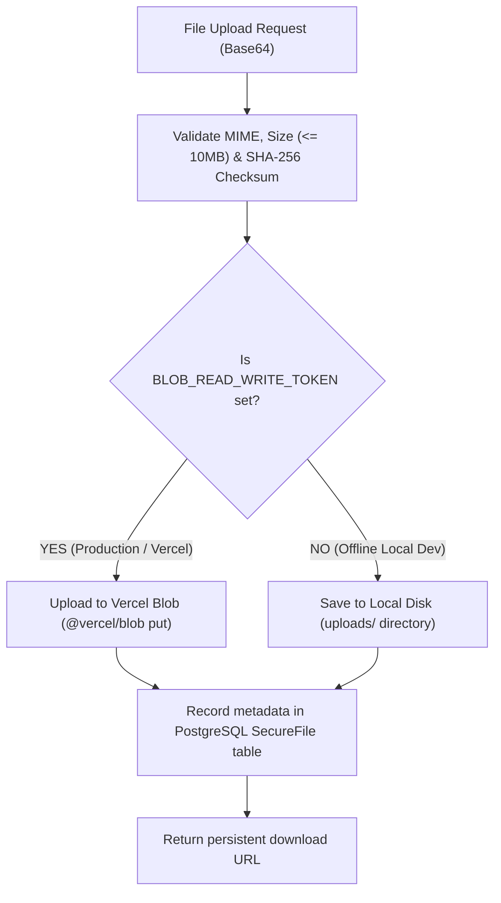

# EduNexa: Persistent Cloud File Storage Migration Guide (Vercel Blob)

This document describes how persistent file storage is handled in EduNexa following the migration from local disk storage to **Vercel Blob**.

---

## 1. Why Vercel Blob?

In serverless architectures (like Vercel Functions), container filesystems are ephemeral and read-only. Any file written to `./uploads/` on disk will be lost as soon as the function terminates or redeploys.

EduNexa implements **Vercel Blob** via the official `@vercel/blob` SDK:
* Scalable object storage distributed globally.
* Persistent file URLs that survive code redeployments.
* Seamless metadata synchronization in PostgreSQL (`SecureFile` table).

---

## 2. Storage Service Architecture (`StorageService`)

Located in `server/src/modules/storage/storage.service.ts`:

---

## 3. Partitioning: Public Assets vs Private Documents

1. **Public Assets** (`isPublic = true`):
   * School logos, website hero banners, public announcements.
   * Path format: `public/[category]/[uuid]_[sanitized_filename]`
   * Served directly via Vercel Blob public edge URL (`blob.url`).
2. **Private Documents** (`isPublic = false`):
   * Student admission proofs, transfer certificates, fee receipts, staff contracts.
   * Path format: `secure/[schoolId]/[category]/[uuid]_[sanitized_filename]`
   * URL format: `/api/v1/storage/files/:id`
   * **Security**: Before serving or redirecting, the endpoint verifies that the requesting user belongs to the same school tenant (enforcing strict tenant isolation) or has `SUPER_ADMIN` privileges.

---

## 4. Enabling Vercel Blob in Production

1. Navigate to the **Storage** tab in your Vercel project dashboard.
2. Click **Create Database** -> Select **Blob**.
3. Link the Blob store to your `edunexa` project.
4. Vercel automatically populates the `BLOB_READ_WRITE_TOKEN` environment variable.
5. In your application, all photo uploads and document attachments will immediately persist to Vercel Blob with no code changes needed.
