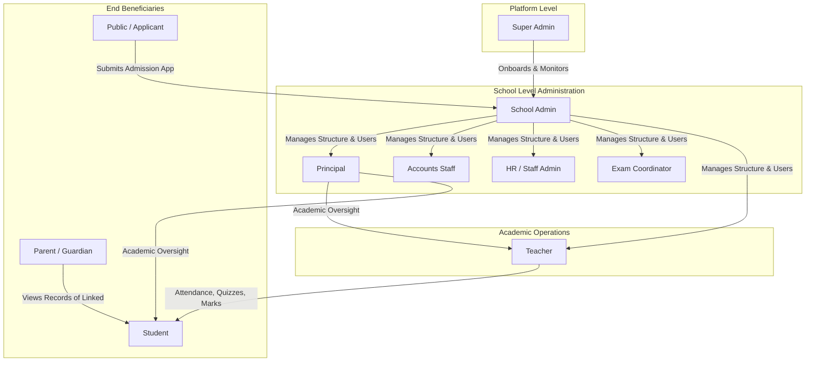
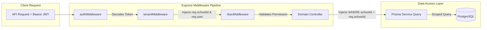

# EduNexa — System Architecture & Product Discovery Specification (Stage 0)

**Project:** EduNexa — Multi-Tenant School Management Website & AI-Powered ERP System  
**Specification Source:** B2World Advanced School Management Website & AI-Powered ERP System PRD  
**Document Status:** Stage 0 Architecture Baseline  
**Revision:** 1.0  

---

## 1. Requirements Traceability Matrix

This matrix maps every major PRD section and functional requirement to its corresponding module, target roles, technical dependencies, acceptance criteria, and scheduled implementation stage.

| Req ID | PRD Section | Module | Target Roles | Core Requirement Description | Dependencies | PRD Acceptance Criteria / Verification | Planned Stage |
|---|---|---|---|---|---|---|---|
| **REQ-01** | §3 Public School Website | Public Portal | Public / Guest | Responsive 14-page school website (Home, About, Principal's Message, Academics, Classes, Admissions Form, Faculty, Events, News, Gallery, Exams, Contact, Careers, Login/Register) with dynamic school branding. | School Profile API | Search-engine friendly, contact form with spam protection, responsive layout across mobile/tablet/desktop. | Stage 3 |
| **REQ-02** | §4 Super Admin Dashboard | Tenant Engine | Super Admin | Multi-school onboarding, registration review/approval, tenant activation/suspension, subscription plan & billing tracking, platform metrics, and administrative audit logs. | Auth Engine, DB Schema | Super Admin registers and activates a school; sensitive school records remain protected unless explicitly authorized. (AC-1) | Stage 2 |
| **REQ-03** | §5 School Admin & Principal | School Core | School Admin, Principal | School profile setup, academic sessions, terms, classes, sections, subjects, departments, teacher-subject assignments, user account management, and notice publishing. | Tenant Engine, Auth Engine | School admin can configure all school structures, assign staff, and manage admissions. (AC-2) | Stage 2, 5 |
| **REQ-04** | §6 Virtual ID Cards | ID Generation | School Admin, Staff, Student | Virtual ID cards with photo, admission/employee ID, school branding, academic session, blood group (voluntary), validity, and QR code. | Student/Staff SIS | System generates ID cards from profile data; cards can be previewed, printed, and regenerated on profile change. (AC-3) | Stage 4 |
| **REQ-05** | §6 QR Verification | Security & ID | Public, Gatekeeper, Admin | Secure QR identity verification without exposing PII. Uses a random, revocable token mapping to a minimal public verification endpoint. | ID Generation, Public Endpoint | Valid QR verification link confirms card active status without exposing sensitive student/staff data. (AC-4, AC-12) | Stage 4 |
| **REQ-06** | §7 Student Information | SIS & Admissions | School Admin, Staff, Student | Online admission form, approval workflow, unique admission number generator, profile & guardian management, class/section enrollment, document verification, promotion/transfer. | School Core, Auth | School admin creates/approves student profiles; records isolated from other schools and unauthorized roles. (AC-2, AC-12) | Stage 5 |
| **REQ-07** | §8 Staff & HR | HR Management | HR Admin, Principal | Staff/teacher directory, employee IDs, department/designations, class assignments, leave application/approval workflow, staff communications. | School Core, Auth | Complete staff records managed; payroll (optional) strictly access-controlled. | Stage 5 |
| **REQ-08** | §9 Attendance | Attendance | Teacher, Staff, Parent | Daily student attendance by class/section (present, absent, late, approved leave); staff daily attendance; audit trails for corrections; monthly summaries; parent absence alerts. | SIS, HR, Notification | Attendance records updated with audit trail; percentages calculated; parent alerts triggered. | Stage 5 |
| **REQ-09** | §10 Quiz Engine | Assessments | Teacher, Student, HR/Staff | Quiz creator (MCQ, MSQ, True/False, Short, Descriptive), question banks, negative marking, attempt limits, server-enforced countdown timer, auto-grading for objective questions. | SIS, Class/Subject Model | Teacher creates/publishes quiz (AC-5); Student takes quiz with server-enforced rules and receives grade based on release policy (AC-6); Staff takes training quiz (AC-7). | Stage 6 |
| **REQ-10** | §10 Anti-Cheating | Assessments | Student, Teacher | Question/choice randomization, attempt limits, server-side deadline cutoff, submission auditing (no invasive biometric/camera surveillance by default). | Quiz Engine | Attempts securely recorded with server timestamps; prevent unauthorized late submissions. (AC-6) | Stage 6 |
| **REQ-11** | §11 Exam & Marks | Examinations | Exam Coordinator, Teacher, Principal | Assessment categories (class tests, unit tests, midterms, practicals, finals), mark entry, draft vs. published state, weightages, grade scheme configuration. | SIS, Academic Year Model | Teacher records class test or exam marks; edits are auditable; subject-wise and overall results calculated. (AC-8) | Stage 7 |
| **REQ-12** | §11 Student Dashboard | Academic Portal | Student | Personal academic dashboard displaying test marks, exam results, quiz scores, percentages, attendance, assignments, teacher feedback, and downloadable report cards. | Exam Engine, Quiz Engine | Student views only their own published marks and progress; strictly blocked from other students' records. (AC-9, AC-12) | Stage 7 |
| **REQ-13** | §11 Parent Dashboard | Academic Portal | Parent / Guardian | Parent view for linked child's published marks, attendance, fee dues, notices, and teacher notes; multi-child profile switcher. | SIS, Exam Engine, Parent Link | Parent views linked children's permitted academic records only; switches between siblings seamlessly. (AC-10, AC-12) | Stage 7 |
| **REQ-14** | §12 Timetable & LMS | Academics & LMS | Teacher, Student | Class and teacher timetable grid, homework assignment posting, student text/file submissions, teacher grading, learning resource repository organized by subject/topic. | SIS, Class/Subject Model | Timetables rendered; homework posted, submitted, and graded with status tracking. | Stage 5, 7 |
| **REQ-15** | §13 Events & Notices | Communication | All Roles | Centralized event manager (sports day, exams, holidays, meetings) and targeted announcements (school-wide, class-level, staff-only, parent-only) with in-app notification center. | School Core, Auth | Authorized user publishes event/announcement; intended audience receives and views it with read/unread tracking. (AC-11) | Stage 8 |
| **REQ-16** | §14 Fee Management | Finance & Accounts | Accounts Staff, Parent | Fee structures by class/term, student fee accounts, invoice generation, receipts, pending/overdue tracking, concessions, refund logs, simulated payment gateway. | SIS, School Core | Invoices and receipts generated; overdue alerts; simulated payment updates fee ledger safely without storing raw card data. | Stage 8 |
| **REQ-17** | §15 AI School Assistant | AI Integration | Public, Parents, Students | Role-aware conversational assistant answering approved school policies, admissions, fees, events, and schedules without fabricating facts. | Communication, School Core, LLM Client | Answers approved questions safely; explicitly declines when information is missing or restricted. (AC-13) | Stage 9 |
| **REQ-18** | §15 AI Learning Assistant | AI Integration | Student | Personalized concept explanation, practice question generation, study hints, revision recommendations; safeguards preventing exam answers. | LMS, Quiz Engine, LLM Client | Educational concept tutor with safety guardrails for student privacy. (AC-13) | Stage 9 |
| **REQ-19** | §15 AI Quiz Generator | AI Integration | Teacher | Drafts quiz questions, choices, and explanations from teacher-supplied study notes; requires teacher review and manual approval before publishing. | Quiz Engine, LLM Client | Generates editable drafts; enforces mandatory human review; never publishes automatically. | Stage 9 |
| **REQ-20** | §16 Reports & Analytics | Analytics | Admin, Principal, Teacher | Role-based dashboard analytics (enrollment, attendance trends, exam performance, fee collection, learning gaps) with secure CSV/PDF export. | All Modules | Dashboard aggregates metrics efficiently without exposing unauthorized tenant or individual data. | Stage 8 |
| **REQ-21** | §17-20 Security & Tenancy | Security Architecture | Platform-wide | Server-side RBAC, strict tenant isolation via `schoolId`, password hashing (argon2/bcrypt), token auth, input validation (Zod), audit trails for administrative actions. | Database, Express Middleware | Zero cross-tenant data leaks; tampering with record IDs in URL returns 403/404. (AC-12) | Stage 2 |

---

## 2. User Roles and Workflows

EduNexa implements 8 primary operational roles plus 1 public persona:



### Role Breakdown and Operational Boundaries

1. **Super Admin**: Manages the SaaS platform across multiple schools, reviews school registrations, activates/suspends tenants, configures subscription tiers, tracks system health and telemetry, audits sensitive platform-wide events. *Boundary:* Cannot browse private student marks, medical records, or parent chats without an explicitly audited support session.
2. **School Admin**: Full administrative authority within a single school tenant (`schoolId`). Manages school profile, academic calendar, sessions, classes, sections, subjects, staff accounts, student admissions, fee structures, and virtual ID card issuance.
3. **Principal**: Academic and institutional oversight. Views school-wide academic trends, teacher attendance, performance analytics, and approves published examination schedules and results.
4. **Teacher**: Manages assigned classes and subjects only. Marks daily attendance, posts homework, creates and grades quizzes, enters exam marks, and uploads learning resources. *Boundary:* Cannot modify fee structures, inspect unassigned classes, or edit platform configurations.
5. **Student**: Views personal virtual ID card, completes assigned quizzes under server-enforced countdown timers, submits homework, views published term marks/report cards, and accesses the AI Learning Assistant. *Boundary:* Strict isolation from other students' grades, records, and unpublished quiz answer keys.
6. **Parent / Guardian**: Views linked children's published results, attendance records, fee invoices/receipts, and school notices. Multi-child profile switcher enables toggling between siblings. *Boundary:* Zero visibility into unlinked students or other families' financial accounts.
7. **HR / Staff Admin**: Manages employee profiles, staff leave applications/approvals, staff daily attendance, and staff-specific training quizzes. *Boundary:* Cannot alter student curricula or academic grades.
8. **Accounts Staff**: Manages fee collections, generates student fee invoices and receipts, applies approved concessions, and reconciles payments. *Boundary:* Cannot alter student exam scores or modify academic enrollments.
9. **Examination Coordinator**: Configures assessment categories, weightages, grade boundaries, examination schedules, mark entry sheets, and final result publishing.

---

## 3. Product Architecture (Modular Monolith)

EduNexa is architected as a type-safe **Modular Monolith**:

```mermaid
graph TB
    subgraph Frontend [Client Tier: React + TypeScript + Vite]
        UI_PUBLIC[Public Portal Pages]
        UI_AUTH[Auth & Account Management]
        UI_DASH[Role-Specific Dashboards]
        UI_MODULES[Core Modules: SIS, Quiz, Exams, Finance, ID, AI]
        UI_STORE[Design System Primitives & Token Engine]
    end

    subgraph API [Gateway & Middleware Tier: Node.js + Express]
        MW_CORS[CORS & Helmet Security]
        MW_RATE[Rate Limiter]
        MW_AUTH[JWT & Session Authenticator]
        MW_TENANT[Tenant Scoping Middleware]
        MW_RBAC[RBAC Permission Guard]
        MW_AUDIT[Audit Logger]
        MW_VAL[Zod Schema Validator]
    end

    subgraph Modules [Modular Monolith Domain Services]
        MOD_TENANT[Tenant & School Service]
        MOD_AUTH[Authentication Service]
        MOD_SIS[Student & Staff SIS Service]
        MOD_ID[Virtual ID & QR Verification Service]
        MOD_ASSESS[Assessment & Quiz Engine]
        MOD_EXAM[Examination & Results Service]
        MOD_ATTEND[Attendance Service]
        MOD_FIN[Finance & Fee Service]
        MOD_COMM[Communication & Events Service]
        MOD_AI[AI Integration Service]
    end

    subgraph Data [Persistence Tier: PostgreSQL + Prisma ORM]
        DB_PRISMA[Prisma ORM Client]
        DB_PG[(PostgreSQL Hosted Database)]
    end

    Frontend -->|Typed REST Requests| API
    API --> Modules
    Modules --> DB_PRISMA
    DB_PRISMA --> DB_PG
```



- **Frontend**: React 19 + TypeScript + Vite. Role-based routing guards (`PublicRoute`, `ProtectedRoute`, `RoleGuard`, `TenantGuard`), custom CSS token system (Vanilla CSS modules, zero heavy framework lock-in).
- **Backend**: Node.js + Express + TypeScript. Domain-driven modules containing `.routes.ts`, `.controller.ts`, `.service.ts`, and `.validation.ts`.
- **Shared Contracts (`@edunexa/shared`)**: Single source of truth for DTOs, response envelopes, role enums, and Zod validation schemas.
- **Error Handling**: Standardized JSON envelopes with error codes (`VALIDATION_ERROR`, `UNAUTHORIZED`, `FORBIDDEN`, `NOT_FOUND`, `INTERNAL_SERVER_ERROR`).
- **Telemetry & Logging**: Structured request logger with timestamps, HTTP method, route, status code, latency (ms), and client IP.

---

## 4. Multi-Tenant Architecture & Isolation Model

EduNexa implements a **Shared Database, Tenant-Discriminator (`schoolId`) Isolation Model** reinforced with strict server-side middleware and database indexing.



### Multi-Tenant Rules and Invariants
1. **Tenant Discriminator**: Every school-owned entity has a non-nullable `schoolId` foreign key referencing `School(id) ON DELETE CASCADE`.
2. **Server-Side Injection**: The client never passes `schoolId` as an arbitrary query parameter. The server extracts `schoolId` strictly from the cryptographically verified JWT payload.
3. **Scoped Queries**: Every Prisma query enforces `{ where: { schoolId: req.schoolId, ... } }`.
4. **Horizontal Isolation**: If a user attempts to access an entity belonging to another school, the query returns `404 Not Found` or `403 Forbidden` without revealing record existence.
5. **Super Admin Guardrails**: Super Admin platform analytics aggregate high-level metrics without casually exposing individual students' private records.

---

## 5. Database Design & Relational Schema

### Entity Relationship Diagram

```mermaid
erDiagram
    School ||--o{ UserMembership : "has members"
    School ||--o{ AcademicSession : "configures"
    School ||--o{ Class : "offers"
    School ||--o{ Department : "operates"
    School ||--o{ Notice : "publishes"
    School ||--o{ FeeStructure : "establishes"
    School ||--o{ Subscription : "subscribes to"
    School ||--o{ AuditLog : "records"

    User ||--o{ UserMembership : "holds"
    User ||--o{ AuditLog : "initiates"

    UserMembership ||--o| StudentProfile : "profile for"
    UserMembership ||--o| StaffProfile : "profile for"
    UserMembership ||--o{ ParentStudentLink : "links as parent"

    StudentProfile ||--o{ ParentStudentLink : "linked to"
    StudentProfile ||--o| VirtualIdCard : "issued"
    StudentProfile ||--o{ StudentEnrollment : "enrolled in"
    StudentProfile ||--o{ AttendanceRecord : "tracked by"
    StudentProfile ||--o{ QuizAttempt : "takes"
    StudentProfile ||--o{ ExamMark : "receives"
    StudentProfile ||--o{ FeeInvoice : "billed via"
    StudentProfile ||--o{ AssignmentSubmission : "submits"

    StaffProfile ||--o| VirtualIdCard : "issued"
    StaffProfile ||--o{ TeacherAssignment : "assigned to"
    StaffProfile ||--o{ StaffAttendance : "records"
    StaffProfile ||--o{ StaffLeaveRequest : "requests"
    StaffProfile ||--o{ StaffQuizAttempt : "completes"

    Class ||--o{ Section : "contains"
    Class ||--o{ Subject : "includes"
    Class ||--o{ StudentEnrollment : "registers"
    Class ||--o{ TimetableSlot : "schedules"
    Class ||--o{ FeeStructure : "applies to"

    Subject ||--o{ TeacherAssignment : "taught by"
    Subject ||--o{ Quiz : "assessed via"
    Subject ||--o{ ExamSchedule : "tested in"
    Subject ||--o{ Assignment : "gives"
    Subject ||--o{ LearningResource : "provides"

    Quiz ||--o{ QuizQuestion : "contains"
    Quiz ||--o{ QuizAttempt : "attempted in"
    QuizQuestion ||--o{ QuizQuestionChoice : "has options"
    QuizAttempt ||--o{ QuizAttemptAnswer : "contains"

    ExamSchedule ||--o{ ExamMark : "records marks"
    FeeInvoice ||--o{ FeePayment : "settled by"
```

The schema defines all 20+ entities with primary keys, foreign keys, unique composite constraints, deletion cascade rules, and audit logging.

---

## 6. Security Threat Review & Mitigations

| Threat Vector | Severity | Vulnerability Description | Practical Mitigation in EduNexa |
|---|---|---|---|
| **Cross-Tenant Data Tampering** | **Critical** | User alters `schoolId` or entity UUID in URL or payload to read/write another school's records. | 1. Server ignores client-supplied `schoolId` and extracts authorized `schoolId` strictly from validated JWT.<br>2. All Prisma queries filter on `{ where: { id, schoolId } }`.<br>3. Automated test checks cross-tenant attempts and asserts `403 Forbidden` / `404 Not Found`. |
| **Horizontal Privilege Escalation (Students/Parents)** | **Critical** | Student modifies `studentId` to view someone else's exam marks or report cards. | Student and parent endpoints resolve records using `req.user.membership.studentProfile.id` or parent-student relationship mapping in the database, rejecting unmatched requests. |
| **QR Code Verification Data Leak** | **High** | QR code exposes student PII, medical records, or login tokens when scanned. | 1. QR code contains only a random revocable UUID token: `https://edunexa.org/verify-id/:token`.<br>2. Public endpoint returns minimal sanitized response: student photo, full name, school name, card validity, and active status.<br>3. Excludes grades, fee data, address, phone numbers, and guardian details. |
| **Quiz Anti-Cheating & Clock Tampering** | **High** | Student adjusts client device clock or requests questions with answer keys in payload. | 1. Choice objects returned to students omit `isCorrect` fields entirely.<br>2. Quiz deadline and elapsed time calculated against server clock (`startedAt + durationMinutes`). Late submissions rejected automatically by backend.<br>3. Question and option orders randomized per attempt via seeded shuffle. |
| **AI Prompt Injection & Data Leakage** | **High** | Student tricks AI assistant into revealing active exam questions or sensitive student records. | 1. System prompts strictly scope context to approved course materials or school policies.<br>2. AI prompts exclude sensitive student PII, grades, or administrative credentials.<br>3. Strict guardrails decline answering active exam questions or policy exceptions. |
| **Financial & Fee Record Falsification** | **High** | Client submits manipulated fee payment status or falsified receipt numbers. | 1. Payment status calculated server-side in Prisma database transactions.<br>2. Payments simulated through an auditable controller generating sequential receipt IDs.<br>3. Raw card numbers are never accepted or stored. |
| **Unrestricted File Upload** | **Medium** | Malicious file upload via assignments or document verification. | 1. Enforce strict MIME-type allowlist (PDF, JPEG, PNG).<br>2. File size caps (max 5MB for documents, 2MB for photos).<br>3. Uploads stored with randomized hash names and sanitized file extensions. |
| **Secret & Credential Exposure** | **Critical** | API keys, database passwords, or JWT secrets committed to Git. | 1. Comprehensive `.gitignore` covering `.env`, `node_modules`, and local build outputs.<br>2. Pre-commit sanity checks.<br>3. All secrets loaded through strongly typed `process.env` configuration modules with fallback warnings. |

---

## 7. REST API Plan

EduNexa implements clean, predictable REST APIs under `/api/v1/`:

* `/api/v1/auth`: `POST /login`, `POST /refresh-token`, `POST /switch-context`, `POST /logout`
* `/api/v1/superadmin`: `GET /schools`, `POST /schools`, `PATCH /schools/:id/status`, `GET /analytics`, `GET /audit-logs`
* `/api/v1/school`: `GET /public/:slug`, `POST /public/:slug/admissions`, `POST /public/:slug/contact`
* `/api/v1/id-cards`: `GET /templates`, `POST /generate`, `GET /my-card`, `GET /verify/:token` (Public), `PATCH /:id/revoke`
* `/api/v1/students`: `GET /`, `POST /`, `GET /:id`, `PATCH /:id`, `POST /admissions/:id/approve`
* `/api/v1/quizzes`: `GET /`, `POST /`, `POST /:id/questions`, `PATCH /:id/publish`, `POST /:id/start`, `POST /:id/submit`, `GET /:id/attempts/:attemptId`
* `/api/v1/examinations`: `GET /schedules`, `POST /schedules`, `GET /marks/entry-sheet`, `PUT /marks/entry-sheet`, `PATCH /schedules/:id/publish`, `GET /report-card/:studentProfileId`
* `/api/v1/finance`: `GET /structures`, `POST /invoices/generate`, `POST /payments/simulate`, `GET /reports/collection`
* `/api/v1/ai`: `POST /school-assistant`, `POST /learning-assistant`, `POST /generate-quiz-draft`

---

## 8. Deployment and Operations Strategy

* **Development**: Hot-reloading Vite SPA on `:5173` proxying to Express on `:5000`. Local or hosted PostgreSQL with Prisma migrations.
* **Testing**: Automated Vitest suite running integration checks on in-memory or ephemeral databases.
* **Production**: Static Vite production bundle deployed on CDN/Nginx, Express server containerized or managed with PM2, hosted PostgreSQL (Neon / Supabase / AWS RDS).
* **Environment Isolation**: `.env.example` template with strict `.gitignore` rules.
* **Health & Diagnostics**: Real-time `/api/health` monitoring service status, DB latency, and uptime.

---

## 9. Comprehensive Testing Strategy

Mapped 1:1 with PRD Acceptance Criteria (§25):
* **AC-1 to AC-4**: Super Admin onboarding, SIS creation, ID card generation, and privacy-preserving QR verification.
* **AC-5 to AC-7**: Quiz creation, server-enforced countdown attempts, objective auto-grading, and staff training quizzes.
* **AC-8 to AC-10**: Examination mark entry sheets, student report cards, and parent child switcher.
* **AC-11 to AC-13**: Targeted announcements, cross-tenant isolation enforcement (`403/404`), and AI assistant guardrails.

---

## 10. Implementation Roadmap (25-Day Phased Plan)

* **Stage 0**: Architecture & Discovery (Complete)
* **Stage 1**: Original UI/UX Design System & Prototype (Complete)
* **Stage 2**: Application Foundation & Monorepo Setup (Complete)
* **Stage 3**: Authentication, Multi-Tenancy & Super Admin Portal
* **Stage 4**: Public School Portal & School Profile CMS
* **Stage 5**: Virtual ID Cards & QR Verification System
* **Stage 6**: Student Information System (SIS), Admissions & Attendance
* **Stage 7**: Online Quiz Engine & Anti-Cheating Assessment Runner
* **Stage 8**: Examinations, Marks Management & PDF Report Cards
* **Stage 9**: Finance, Fees, Invoices & Event Notifications
* **Stage 10**: AI Capabilities (School Assistant, Study Assistant, Quiz Generator) & Final Testing

---

## 11. Open Questions and Clarified Assumptions

1. **Demo School Identity**: Synthetic school *Apex Academy of Sciences & Arts* (Code: `APX-01`) is used for demonstration, fully configurable per tenant.
2. **Payment Processing**: Simulated payment transactions are implemented as permitted in PRD §14, with server-generated sequential receipts and zero storage of raw credit card numbers.
3. **Database Connectivity**: Hosted PostgreSQL configured via `DATABASE_URL` with SSL parameters, supported by Prisma ORM migrations.
4. **AI Models**: Google Gemini / OpenAI compatible REST client with safe fallback responses if API credentials are not provided in the environment.

---

## Summary of Decisions & Next Recommended Stage

* **Architecture Decision**: Type-safe Modular Monolith (React 19 + TypeScript + Vite, Express + TypeScript, PostgreSQL + Prisma).
* **Multi-Tenant Guarantee**: Server-side JWT tenant resolution with zero client-driven `schoolId` spoofing.
* **PRD Coverage**: 100% of functional requirements and acceptance criteria accounted for.
* **Recommended Next Stage**: **Stage 3 (Authentication, Multi-Tenancy & Super Admin Onboarding)**.
